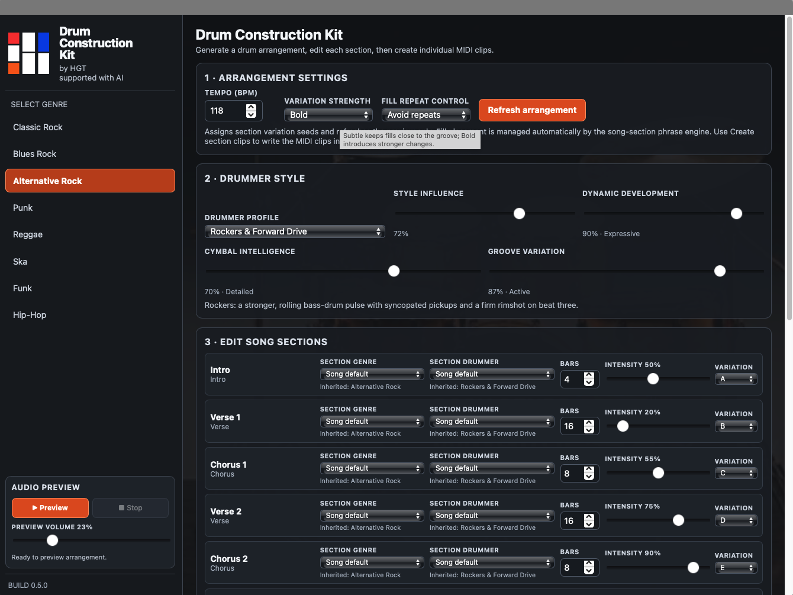

# Drum Construction Kit

### by HGT · Developed with AI assistance

**Build your drum arrangements. Shape your drummer. Create your sound.**

The Drum Construction Kit is a creative drum arrangement tool for Ableton Live.

It helps musicians build complete drum arrangements with individual song sections, genre-specific grooves, drummer profiles, dynamic variations and musical development.

Instead of simply repeating static MIDI loops, the Drum Construction Kit provides a structured workflow for creating drum performances that evolve throughout a song.

---

## 1. Key Features

### Genre Selection

Choose from eight musical styles:

- Classic Rock
- Blues Rock
- Alternative Rock
- Punk
- Reggae
- Ska
- Funk
- Hip-Hop

### Arrangement Settings

- **Tempo (BPM):** Set the song tempo.
- **Variation Strength:** Choose between subtle and bold variations.
- **Fill Repeat Control:** Control the repetition of fill patterns.
- **Refresh Arrangement:** Generate a refreshed arrangement with new variation seeds.

### Drummer Style Engine

Shape the personality and playing character of your drummer.

- **Drummer Profiles:** Select different playing styles and musical characters.
- **Style Influence:** Control the influence of the selected drummer profile.
- **Dynamic Development:** Adjust the expressive development of the performance.
- **Cymbal Intelligence:** Influence cymbal playing and musical detail.
- **Groove Variation:** Control the amount of groove variation.

### Edit Song Sections

Build your arrangement section by section.

Each section can have its own settings:

- Section Genre
- Section Drummer
- Bar Length
- Intensity
- Variation

Create and edit song sections such as Intro, Verse, Chorus and Bridge.

Genre and drummer settings can be inherited from the main arrangement or assigned individually to each section.

### Fill & Variation Management

Create musical development instead of endlessly repeating the same drum pattern.

- Control fill repetition.
- Introduce changing drum variations.
- Develop different performances across song sections.
- Create transitions between musical sections.

### Solo Engine

Create genre-specific drum solos with different playing characters, phrasing approaches and musical expressions.

### Audio Preview

Listen to your arrangement before creating MIDI clips.

- Preview arrangement
- Stop playback
- Adjustable preview volume

### MIDI Clip Creation

Generate individual MIDI clips for your song sections.

The generated clips are arranged vertically underneath each other in a single Ableton Live track, allowing you to work with the song structure and use Ableton Live Follow Actions.

**Important — Prepare at least 8 empty clip slots**

Before creating MIDI clips, make sure that the target MIDI track in Ableton Live has at least **8 consecutive empty clip slots** available. The Drum Construction Kit uses these slots to place the generated section clips vertically, one below another. Existing clips or other content in the required slots may prevent the arrangement from being written.

The MIDI clips can be further edited and adapted to your production.

---

## 2. How to Use

**Step 1 – Select a Genre**

Choose one of the eight available musical styles.

**Step 2 – Set Arrangement Parameters**

Define the tempo, variation strength and fill repeat behaviour.

**Step 3 – Choose Your Drummer**

Select a Drummer Profile and adjust Style Influence, Dynamic Development, Cymbal Intelligence and Groove Variation.

**Step 4 – Build Your Song Structure**

Edit the individual song sections. Set their genre, drummer, bar length, intensity and variation.

**Step 5 – Preview Your Arrangement**

Listen to your arrangement and adjust the parameters.

**Step 6 – Create MIDI Clips**

Generate the individual MIDI clips and continue working with them directly in Ableton Live.

**Closing the Extension Without Generating MIDI**

If you want to close the extension without generating or inserting MIDI clips, simply click the **Cancel** button.

This closes the extension without creating or transferring any MIDI data to Ableton Live. Existing clips and MIDI content remain unchanged.

---

## 3. Installation & Requirements

### System Requirements

- Ableton Live Suite Beta 12.4.5 or later.
- macOS or Windows systems supported by Ableton Live.
- Ableton Live JavaScript Extensions support.

**Important:** Ableton Extensions are not available in Live Standard, Intro or Lite.

### Installation

1. Download the latest `.ablx` file from GitHub Releases.
2. Open Ableton Live.
3. Navigate to **Settings / Preferences → Extensions**.
4. Select **Install Extension** and choose the downloaded `.ablx` file. Alternatively, drag the `.ablx` file onto the Extensions settings page.
5. Restart Ableton Live if required.

### Updates

1. Visit the GitHub Releases section.
2. Download the latest `.ablx` package.
3. Install the updated extension through Live's Extensions settings.
4. Restart Live if required.

---

## 4. Compatibility & Technology

- Built with the Ableton Live JavaScript Extensions SDK.
- Requires Ableton Live Suite with Extensions support, version 12.4.5 or later.
- Currently tested with Ableton Live 13 Beta.
- Available as an installable Ableton Extension (`.ablx`).

No separate JavaScript development environment or SDK installation is required to use the pre-built `.ablx` package.

---

## 5. Audio Assets, Sources & Licenses

### Audio Preview — Phazite Sounds

The audio preview in Drum Construction Kit 0.8.0 uses **37 embedded MP3 sound assets from Phazite Sounds**, documented under the **CC0 1.0 Universal** dedication.

- **Sound source:** [Phazite Sounds](https://github.com/august-byrne/phazite-sounds)
- **License:** [CC0 1.0 Universal](https://creativecommons.org/publicdomain/zero/1.0/)

The sound set contains four velocity layers each for Kick, Snare, Rim / Side Stick, Low Tom, Mid Tom, High Tom, Closed Hi-Hat, Open Hi-Hat and Ride, plus one dedicated long-decay Crash one-shot.

The documented MIDI velocity bands are 1–31, 32–63, 64–95 and 96–127. The audio assets are embedded in the extension; the original WAV/FLAC source recordings are not included as loose files.

HGT names Phazite Sounds as the source for transparency. The sound asset provenance, payload sizes and SHA-256 hashes are recorded in `SOUND-ASSETS.md` and `SOUND-ASSET-MANIFEST.json` in the source package.

### Artwork

The HGT banner, logo and visual elements are original artwork created by HGT, with AI assistance based on HGT's own descriptions and creative direction. Their geometric visual language is inspired by Piet Mondrian; they are not reproductions of Mondrian artworks.

### MIDI Mapping Compatibility

Selectable third-party drum layouts, including Toontrack/EZdrummer where available, refer to MIDI note mapping only. They identify the note assignments used for drum instruments. No Toontrack/EZdrummer audio recordings, samples, presets or software are included.

Such product names are used solely to identify technical compatibility and do not imply endorsement, partnership or affiliation.

### Project and Third-Party Licenses

The HGT License 1.0 applies only to original Drum Construction Kit project material owned or controlled by HGT. It does not replace or change the separate CC0 1.0 dedication for the Phazite sound assets or the license terms for Ableton Extensions SDK components.

For detailed information, see the individual documentation files:

- [LICENSE.md](Documentation/LICENSE.md) — HGT License 1.0
- [THIRD-PARTY-NOTICES.md](Documentation/THIRD-PARTY-NOTICES.md) — third-party components and notices
- [ABLETON-EXTENSIONS-SDK-LICENSE.md](Documentation/ABLETON-EXTENSIONS-SDK-LICENSE.md) — Ableton SDK license
- [SOUND-ASSETS.md](Documentation/SOUND-ASSETS.md) — sound sources and licensing
- [SOUND-ASSET-MANIFEST.json](Documentation/SOUND-ASSET-MANIFEST.json) — audio file hashes and byte lengths
- [COPYRIGHT.md](Documentation/COPYRIGHT.md) — project credits and copyright information

For the central documentation covering all three HGT Ableton Extensions:

- [Sources & Documentation](https://github.com/hgtroester-ai/hgt-ableton-extensions/tree/main/Documentation)
- [Sources — English](https://github.com/hgtroester-ai/hgt-ableton-extensions/blob/main/Documentation/SOURCES.md)
- [Quellen — Deutsch](https://github.com/hgtroester-ai/hgt-ableton-extensions/blob/main/Documentation/SOURCES_DE.md)

---

## 6. Use and Responsibility

This extension is developed by HGT on a voluntary basis and provided free of charge.

It is developed and tested with care, but errors or compatibility issues cannot be completely ruled out. Use is at your own responsibility.

Please save and back up your Ableton Live projects and related files regularly, especially before installing or updating this extension.

No guarantee of error-free or uninterrupted operation is provided. Liability for damages or data loss is excluded to the extent permitted by applicable law. Mandatory statutory rights remain unaffected.

---

## 7. Downloads

**Latest release: Drum Construction Kit 0.8.0**

- [Download installable Ableton Extension (.ablx)](https://github.com/hgtroester-ai/drum-construction-kit/releases/download/v0.8.0/Drum_Baukasten_0.8.0.ablx)
- [Download complete source code (.zip)](https://github.com/hgtroester-ai/drum-construction-kit/releases/download/v0.8.0/Drum_Baukasten_0.8.0_Source.zip)

Check [GitHub Releases](https://github.com/hgtroester-ai/drum-construction-kit/releases) for version numbers, updates and release notes.

---

## 8. About HGT

**The only good system is a sound system.**

Music connects people.

Independent development, creative ideas and a passion for music.

**HGT – Developed with passion. Shared freely.**

Free to use. Independently developed.
